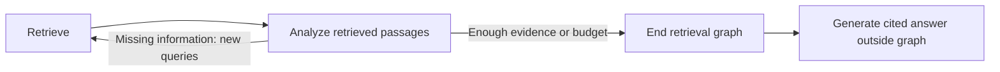
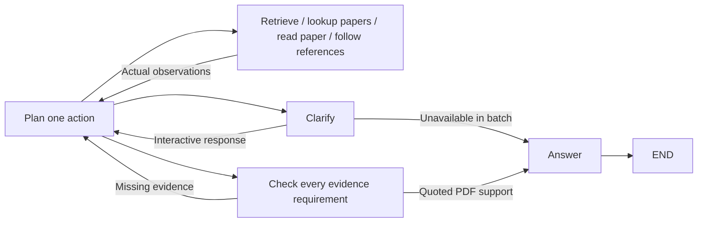

# Module 5 — Agent-based Research Paper Navigator

Checkpoint 5.1 extends the Module 4 hybrid retriever with the actual LangGraph
patterns taught in Labs 5.1 and 5.2. The completed worksheet and current evidence
are under `assignment/`. The superseded Python-loop implementation and its results
are archived under `assignment/archive/pre_langgraph/` and are excluded from the
current evaluation.

## Setup and isolation

All implementation changes, dependencies added for this checkpoint, index writes,
and evidence are under Module 5. Module 4's retrieval backend, research graph, and
annotations were copied locally. The original 153 PDFs and API key are read from
Module 1. The existing vector index is copied into Module 5 because Chroma may
write bookkeeping information when opened; the corpus is not re-embedded.

Use the existing repository virtual environment. Install the pinned additions
into the module-local target in one command so namespace packages merge correctly:

```bash
.venv/bin/python -B -m pip install --no-deps --upgrade --target module_5/.python_packages -r module_5/agent-requirements.txt
.venv/bin/python -B module_5/assignment/prepare_checkpoint_5.py
.venv/bin/python -B module_5/assignment/capstone_checkpoint_5_1_agent_rag_starter.py --plan
.venv/bin/python -B module_5/assignment/capstone_checkpoint_5_1_agent_rag_starter.py --mode refined --query "Compare CVC4SY and adaptive concretization as synthesis search strategies."
.venv/bin/python -B module_5/assignment/capstone_checkpoint_5_1_agent_rag_starter.py --chat
```

The existing environment supplies LangChain, Chroma, PyMuPDF, and other retrieval
dependencies. The agent imports LangGraph from `module_5/.python_packages`.
The chat model is `openai/gpt-5.4-mini`; embeddings use
`openai/text-embedding-3-small`, through `https://openrouter.ai/api/v1` with
`OPENROUTER_API_KEY` from the environment or `module_1/assignment/.env`.
Credentials are neither printed nor saved in evidence. API evaluations send
questions and retrieved passages to this configured service.

## Lab-aligned workflows



The initial version follows Lab 5.1: retrieve, analyze actual passages, and loop
conditionally. It permits three rounds and up to two follow-up queries per round.



The refined version follows Lab 5.2: the model selects one action, Python validates
and executes it, and its result returns to planning. There is no preplanned search
queue. Four LangChain `StructuredTool` objects implement:

- `retrieve`: inherited BM25/vector hybrid search, three passages per query.
- `lookup_papers`: deterministic title/author substring and exact-year filtering,
  adapting the lab's date-filter tool to the paper corpus.
- `read_paper`: local BM25 passage search inside an observed PDF, without embeddings.
- `follow_references`: discovery of validated in-corpus citation targets.

Catalogue and citation metadata are discovery hints, never answer evidence.
Only observed filenames can be read. State retains twelve deduplicated passages;
the refined graph allows eight tool/clarification actions. Planner decisions use
schema-constrained output. Invalid active arguments receive at most two corrective
decisions, while duplicate tools never execute twice. Before answer generation, a
question-derived checklist is assessed with a fixed-field schema that requires one
result per requested dimension. Supporting quotations are matched to cited PDF
text; missing evidence returns to planning. Interactive clarification returns to
planning; batch runs never block on user input. Each query starts with fresh
evidence and explicit conversation history. The answer generator receives the
same grounded prompt in all conditions.

The retriever preserves 1,200-character chunks, 200-character overlap, a candidate
pool of twelve, and BM25/vector weights of 0.45/0.55. See the detailed
[lab mapping](assignment/lab_alignment.md) and exported compiled graphs in evidence.

## Evaluation and reproducibility

The worksheet asks for two or three representative multistep cases; it does not
require particular papers. The three questions were selected unchanged from
Module 4's test inputs: benchmark comparison, self-repair synthesis, and synthesis
search strategies. Reference answers and grading notes are used only by the
separate evaluator, never passed to the planner or retriever.

- `baseline`: one original-question hybrid search, three chunks.
- `baseline_wide`: one search, up to twelve chunks, controlling for context size.
- `initial`: Lab 5.1 retrieve/analyze graph.
- `refined`: Lab 5.2 tool-selection graph with the documented refinements.

```bash
.venv/bin/python -B -m unittest discover -s module_5/assignment -p test_agent_rag.py -v
.venv/bin/python -B module_5/assignment/evaluate_checkpoint_5.py --modes baseline baseline_wide initial refined --output-dir module_5/assignment/evidence/rerun
.venv/bin/python -B module_5/assignment/report_checkpoint_5.py
.venv/bin/python -B module_5/assignment/audit_checkpoint_5.py
```

The evaluator saves answers before grading, plus passages, tool traces, token
usage, model settings, prompts, and hashed source snapshots. It refuses to
overwrite existing runs; `--resume` requires matching source fingerprints.
The rerun command above uses a separate directory. Report/audit scripts inspect
the recorded comparison at `assignment/evidence/`; they do not regrade a rerun.
The assistant's criterion-level passage reviews are a separately recorded artifact.

Twenty-three offline tests exercise the actual compiled graphs, observation-driven
routing, fixed-field coverage recovery, quote provenance, schema validation,
budgets, clarification, and state isolation. The final
audit verifies original PDF passages, fixed cases, source snapshots, worksheet
structure, and preservation of earlier-module files against the local manifest.
A clean-clone audit cannot verify historical preservation without that ignored
local manifest; it reports that limitation rather than inventing a result.

## Interpreting the results

The final passage review found 5/11 criteria covered by the fixed baseline,
9/11 by wider fixed retrieval, 7/11 by the initial graph, and 11/11 by the refined
graph. Whole-task completion was 0/3, 1/3, 1/3, and 3/3 respectively. The raw judge
passed 2/3 refined tasks while marking all eleven criteria complete and supported;
its benchmark `unsupported_claims` list contains two supported claims and one
honest context limitation, so the separate review records that task as passing.
The improvement costs more: 29 model calls, 72,225 tokens, and 15.55 seconds median
latency for the refined condition, versus 8 calls, 17,410 tokens, and 8.84 seconds
for the initial graph.

Read the [evaluation report](assignment/evidence/evaluation_report.md) for raw
model grades, separately reviewed criteria, full refined answers, and action traces.
The [summary](assignment/evidence/summary.json) is generated from the saved runs.
Automated grades sometimes credit facts missing from an answer or reject supported
claims. Passage reviews
are assistant-conducted and are not independent human validation.

Elapsed times exclude corpus initialization and judging. Chat usage excludes
judge calls and embeddings; one failed judge attempt's tokens were not captured.
Embedding requests and successful judge usage are reported
separately. Dollar cost was not measured. Three development questions and one run
per final condition cannot establish general superiority or isolate the effect of
each refinement. Twenty-one LangGraph development runs are retained in evidence
directories ending in `_pilot`; their 143 calls and 345,308 tokens are reported
separately. Earlier pre-LangGraph results are excluded entirely.

## Deliverables

- [Completed worksheet](assignment/capstone_checkpoint_5_worksheet_responses.md)
- [Completed Python starter](assignment/capstone_checkpoint_5_1_agent_rag_starter.py)
- [Lab alignment](assignment/lab_alignment.md)
- [Evaluation report](assignment/evidence/evaluation_report.md)
- [Review notes](assignment/evidence/review_notes.md)
- [Final audit](assignment/evidence/final_audit.json)
